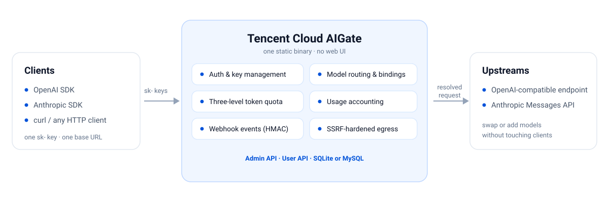

<p align="center">
  
</p>

<h1 align="center">路由、管控与记账每一次模型调用，只需一个二进制</h1>

<p align="center">
  <a href="README.md">English</a> | <a href="README.zh-CN.md">简体中文</a>
</p>

<p align="center">
  <a href="LICENSE"></a>
  <a href="go.mod"></a>
  <a href="CHANGELOG.md"></a>
</p>

**Tencent Cloud AIGate 是自托管的企业级 LLM API 网关——纯 API 服务，无前端。**
它把 OpenAI 格式与 Anthropic 格式的请求转发到 OpenAI 兼容端点或 Anthropic
Messages API，逐请求记录用量、执行 token 配额，并通过 webhook 投递签名事件。

**来历。** AIGate 由 [ClawPro](https://cloud.tencent.com/document/product/213/129156)
孵化——腾讯云开箱即用的一站式企业 AI 智能体管控平台。ClawPro 帮助企业零代码、
分钟级为全员规模化部署安全可控的专属数字助手：成员与权限集中管理、模型与知识库
配置、主流 IM 通道一键接入、资源与成本实时监控。

正是企业场景的打磨塑造了这个网关：AIGate 是 ClawPro 的模型接入层，多级配额、
按密钥的模型绑定、完整用量记账、出站安全加固等企业级要求，都是它的默认能力而非
附加项。它由经生产验证的 LLM proxy 抽取而来，行为对应已经跑过生产的请求模式与
失败模式。完整的来历与设计理念见 [docs/why-aigate.zh-CN.md](docs/why-aigate.zh-CN.md)。

**状态：** v0.1.0 —— 发布记录见 [CHANGELOG.md](CHANGELOG.md)，下一步计划见
[docs/ROADMAP.zh-CN.md](docs/ROADMAP.zh-CN.md)。

<p align="center">
  
</p>

## 为什么用 AIGate

- **保留你的 SDK，也保留你的上游** —— 客户端可用 OpenAI 或 Anthropic 协议，
  上游同样两种皆可；协议不一致时网关做转换，一致时原生直通。
- **无需平台团队也能管控** —— 按密钥的模型绑定、三级配额、用量记账与事件
  webhook 全部内置；不需要维护代理集群或边车。
- **随处可跑** —— 单个静态二进制或非 root 容器；笔记本用 SQLite，生产用 MySQL。

## 特性

- **双协议数据面** —— `POST /v1/chat/completions`、`POST /v1/messages`
  （Anthropic Messages 入站）与 `GET /v1/models`，以 `sk-` 密钥鉴权；密钥只存哈希、
  不落明文。
- **Anthropic 入站与直通保真** —— 鉴权接受 `x-api-key`（优先）或
  `Authorization: Bearer`；`anthropic-messages` 上游收到原生请求（`cache_control`
  等 Anthropic 专有字段不丢失），OpenAI 兼容上游则完成请求/响应/SSE 的双向转换。
- **双上游适配** —— 同一条请求链路可到达 OpenAI 兼容端点或 Anthropic Messages
  端点。
- **按密钥的路由规则** —— 大小写不敏感的模型解析（支持 `provider/model_id`
  前缀精确指定同名模型的来源）+ primary 回退、上游模型名强制替换、`max_tokens`
  上限强制，以及可选的请求头透传。
- **配额与用量记账** —— 四级 token 配额（全局 → 模型 → 用户 → 密钥），超限返回
  `429`/`Retry-After`；全局配额支持组级规则覆盖；请求级明细 + 日聚合（含 cache
  read/write token），异步写入，不阻塞转发；支持 CSV/JSON 用量导出与单密钥趋势。
- **凭据托管** —— 上游凭据与模型分离管理，由 `credential_id` 引用；读取时掩码，
  配置主密钥后以 AES-256-GCM 加密落库。
- **存量导入** —— `POST /admin/import` 一次导入存量分组、用户、模型与密钥，幂等且
  支持干跑。
- **连通性测试** —— `POST /admin/models/{id}/connectivity` 以最小请求探测上游，返回
  结构化的错误分类。
- **用户自助密钥** —— 用户在 `/api/user/keys` 下自行签发与 rotate 密钥，受每用户
  数量上限与「由既有密钥推导出的模型范围」约束；另提供单密钥用量趋势接口。
- **用户自备 Key（BYOK）** —— 模型可标记 `user_key_required`：不保存共享密钥，
  由每条密钥绑定各自携带上游密钥（加密落库、永不回显），逐请求按绑定隔离解析。
- **密钥生命周期** —— 密钥可选有效期（`expires_at`，RFC 3339；显式 `null` 清除），
  `expired_at` 记录首次过期拒绝：过期密钥按「无效凭据」拒绝并发出一次 `key.expired`
  （同一有效期内不重复）；删除模型时自动把剩余绑定中 `sort_order` 最小者提升为 primary。
- **webhook 事件出口** —— `request.completed`、`quota.exceeded`、`key.disabled`、
  `key.expired` 异步投递，带 HMAC-SHA256 签名与失败重投，投递记录可查（超过
  `-webhook-delivery-retention-days` 的记录会被自动清理，默认 7 天）。
- **管理面 API** —— `/admin/*` 下提供模型、凭据、密钥、用户、分组、设置、webhook、
  导入与用量查询；仅 Bearer 鉴权，无前端。
- **加固的出站链路** —— 所有上游请求（以及每次 webhook 投递）都经过 SSRF 防护：
  URL 校验、拨号时二次解析、重定向校验。
- **单二进制与容器** —— 静态编译；多阶段 `Dockerfile` 以非 root 用户运行并带健康检查。

## 快速开始（SQLite）

需要 Go 1.24+。

```bash
make run
```

`make run` 会构建 `bin/aigate`，并基于本地 SQLite 文件启动。等价的显式命令为：

```bash
go run ./cmd/aigate -db-type sqlite -db-dsn aigate.db -init-admin-token dev-admin-token
```

指定 `-init-admin-token` 时，首次启动会用该 token 创建管理员；之后再启动是幂等的
（管理员已存在时该 flag 被忽略并记一条日志）。不指定该 flag 时，网关会自动生成
管理员 token 并在 stdout 打印一次（仅此一次）。

`-master-key` / `AIGATE_MASTER_KEY` 是**可选**的。未配置时，`ai_models.api_key`
与凭据中的密钥值以明文存储，网关会在启动时输出安全告警；配置后即加密落库（见
[docs/deploy.zh-CN.md](docs/deploy.zh-CN.md)）。

### 最小闭环示例

下面用到的 `1`（模型）与 `2`（用户）是该流程在全新数据库上创建的 ID，请按你自己
调用返回的 ID 替换。

```bash
ADMIN=dev-admin-token
BASE=http://127.0.0.1:8080

# 1) 注册上游模型。model_type 决定适配器：
#    - openai-completions：url 为 OpenAI 兼容基地址；网关仅在其后拼接 /chat/completions
#      （如 OpenAI 为 .../v1，智谱为 .../api/paas/v4）
#    - anthropic-messages：url 为 host（网关拼接 /v1/messages）
curl -sS "$BASE/admin/models" \
  -H "Authorization: Bearer $ADMIN" -H 'Content-Type: application/json' \
  -d '{
        "provider": "zhipu",
        "model_id": "glm-5.1",
        "model_name": "GLM-5.1",
        "url": "https://open.bigmodel.cn/api/paas/v4",
        "api_key": "<上游密钥>",
        "model_type": "openai-completions"
      }'

# 2) 创建数据面密钥的所属用户
curl -sS "$BASE/admin/users" \
  -H "Authorization: Bearer $ADMIN" -H 'Content-Type: application/json' \
  -d '{"username": "demo"}'

# 3) 签发绑定该模型的密钥，sk- 明文只返回这一次
curl -sS "$BASE/admin/keys" \
  -H "Authorization: Bearer $ADMIN" -H 'Content-Type: application/json' \
  -d '{"name": "demo-key", "user_id": 2,
       "bindings": [{"ai_model_id": 1, "role": "primary"}]}'

# 4) 用 sk- 密钥经网关转发请求。同一 token 也可用 x-api-key 走 Anthropic 兼容入站
curl -sS "$BASE/v1/chat/completions" \
  -H "Authorization: Bearer sk-..." -H 'Content-Type: application/json' \
  -d '{"model": "GLM-5.1", "messages": [{"role": "user", "content": "hello"}]}'

curl -sS "$BASE/v1/messages" \
  -H "x-api-key: sk-..." -H 'Content-Type: application/json' \
  -d '{"model": "GLM-5.1", "max_tokens": 64,
       "messages": [{"role": "user", "content": "hello"}]}'
```

请求体的 `model` 会与该密钥绑定的 `model_id` 做大小写不敏感匹配；同名模型存在多个
来源时，用 `provider/model_id` 前缀指定来源（如 `qcloudlkeap/deepseek-v3.2`）——前缀
也可用保存绑定时生成的拼接形态 `{provider}-{model_id}`（如 `hatchery-glm-4-plus/glm-4-plus`）。
完全不带 `model` 则回退到绑定的 primary 模型。请求体加入 `"stream": true` 即走 SSE。`GET /v1/models`
列出该密钥已启用的模型，`GET /healthz` 是免鉴权的存活探针。

## 生产部署（MySQL）

SQLite 仅用于本地（单写、无法多副本部署）。生产使用 MySQL：建库、导入
`sql/init.sql`，再把 `-db-dsn` 指向该库。完整步骤、配置项全表、凭据加密操作手册、
Docker 说明与上游 SSRF 策略见 [docs/deploy.zh-CN.md](docs/deploy.zh-CN.md)。

## 配置简表

每项配置都同时提供 flag 与 `AIGATE_*` 环境变量；优先级为 flag > 环境变量 > 默认值。

| Flag | 环境变量 | 默认值 | 说明 |
|------|----------|--------|------|
| `-addr` | `AIGATE_ADDR` | `:8080` | 监听地址 |
| `-db-type` | `AIGATE_DB_TYPE` | `sqlite` | `sqlite` 或 `mysql` |
| `-db-dsn` | `AIGATE_DB_DSN` | `aigate.db` | SQLite 文件路径或 MySQL DSN |
| `-timezone` | `AIGATE_TIMEZONE` | `Asia/Shanghai` | 配额窗口与日聚合使用的 IANA 时区 |
| `-usage-buffer` | `AIGATE_USAGE_BUFFER` | `256` | 用量异步写入队列容量（须 >= 1） |
| `-webhook-buffer` | `AIGATE_WEBHOOK_BUFFER` | `256` | webhook 事件投递队列容量（须 >= 1） |
| `-webhook-delivery-retention-days` | `AIGATE_WEBHOOK_DELIVERY_RETENTION_DAYS` | `7` | `webhook_deliveries` 记录保留天数（`0` = 永久保留；须 >= 0） |
| `-quota-exceeded-status` | `AIGATE_QUOTA_EXCEEDED_STATUS` | `429` | 配额超限状态码（`429` 或 `403`） |
| `-init-admin-token` | `AIGATE_INIT_ADMIN_TOKEN` | （空） | 初始管理员 token；为空时自动生成并打印一次 |
| `-allow-private-upstreams` | `AIGATE_ALLOW_PRIVATE_UPSTREAMS` | `false` | 放行私网/回环上游（放宽 SSRF 严格模式） |
| `-master-key` | `AIGATE_MASTER_KEY` | （空） | AES-256-GCM 主密钥（64 hex 或 base64 的 32 字节）；空 = 明文 + 告警 |
| `-migrate-encrypt` | — | `false` | 一次性开关：加密存量明文密钥行后退出（需主密钥） |

非法配置会在启动阶段被直接拒绝，而不是静默兜底。`-version` 打印
`Tencent Cloud AIGate 0.1.0` 后退出。权威配置表见 [docs/deploy.zh-CN.md](docs/deploy.zh-CN.md)。

## 文档索引

| 内容 | 位置 |
|------|------|
| 背景与设计理念 | [docs/why-aigate.zh-CN.md](docs/why-aigate.zh-CN.md) |
| API 参考 —— 端点、请求体与示例 | [docs/API.zh-CN.md](docs/API.zh-CN.md) |
| 部署、配置、加密与 Docker | [docs/deploy.zh-CN.md](docs/deploy.zh-CN.md) |
| OpenAPI 3.0 文档 | [docs/openapi.yaml](docs/openapi.yaml) |
| 变更日志 | [CHANGELOG.md](CHANGELOG.md) |

## 参与贡献

欢迎在仓库提 Issue 或 MR。

## License

Apache-2.0 —— 见 [LICENSE](LICENSE)。
